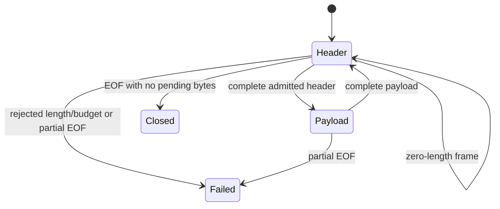

# Byte-stream framing lab

A bounded offline Python learning tool showing how opaque records survive split
headers, split payloads and coalesced chunks. It also demonstrates partial EOF,
early length rejection, accepted-prefix evidence and persistent failure state.
Only invented byte fixtures are in scope. Custom `u32be-records-v1` is four unsigned
big-endian header bytes followed by the declared number of payload bytes.

## Run

Python 3.11+ standard library; locally verified on Windows Python 3.13.7.
No package installation, service, network access or administrator rights needed.
From this directory:

```powershell
python framing_lab.py examples/split.json
python framing_lab.py examples/prefix-failure.json
Get-Content examples/open.json -Raw | python framing_lab.py -
python -m unittest discover -s tests -v
python -O -m unittest discover -s tests -v
```

The split demo reconstructs payload `414243` at wire span [0,7) and an empty frame
at [7,11). The prefix-failure demo accepts `41` at [0,5), detects a 4097-byte
declaration at offset 9, and ignores eight suffix bytes. The open demo retains one
of three declared payload bytes and reports two still needed. EOF and open state
are supplied assumptions, not transport observations.

Exit 0: valid open/closed simulation; 3: framed-stream failure with accepted prefix;
2: admission or I/O error. Admission errors return no report. Output is JSON with
reversible lowercase payload hex; it is not redacted or decoded into terminal text.
An output failure can leave partial bytes but must return 2.

## Architecture and security model

`analyze(data: exact bytes) -> dict` validates the whole bounded JSON representation
before processing. Internal cursor-driven decoder state carries across admitted
chunks. Report encoding is bounded before API return and CLI delivery.



Failed/closed states reject later feeds without resynchronization. Failure records
preserve pending counts before clearing carry. Completed payload, current reserved
length and actual pending storage are different quantities; completing a frame
transfers reservation without charging it twice. [SCHEMA.md](SCHEMA.md) specifies
all fields, offset conventions, limits and terminal behavior.

Limits: 256 KiB input JSON, 256 chunks, 4096 bytes per chunk/frame, 64 KiB supplied
wire bytes, 64 accepted frames, 16 KiB aggregate accepted/reserved payload and
256 KiB encoded report. These are logical bounds; no hard process RSS/time limit
or parser/security certification is claimed. Payload interpretation/execution,
sockets, captures, actual TCP, RFC 6587 compatibility and real logs are excluded.
See [SECURITY.md](SECURITY.md).

## Verified learning evidence

28 tests pass in normal and optimized Python, including 256 partitions of an
independent nine-byte literal stream, EOF/failure partition equivalence, budget
boundaries, terminal state and actual closed receiving pipes. Seven demos match
fixed expected states/statuses. Two restored mutations produce assertion failures;
Bandit 1.9.4 reports zero findings/errors with narrow test/verifier-only subprocess
exclusions. ECC self-review reproduced/fixed a diagnostic failure path.
See [verification/REPORT.md](verification/REPORT.md) and the hashed receipt/logs.

Repeat the complete check with `python verification/verify.py` when Bandit is
already installed. The helper uses fixed local subprocesses, temporarily mutates
only this module, restores its exact bytes in `finally`, removes only its own derived
cache files, and overwrites verification logs/receipt on a successful run. Do not
run it concurrently with edits or another verification process. A forced process
termination can bypass `finally`; preserve work before running it. This is an
owned-source regression experiment, not third-party code execution or containment.

No Linux, other Python version, hosted CI/CodeQL, dedicated secret/history scanner
or independent audit run is claimed. Earlier scanner live Linux SYN remains unrun.

## Attribution and learning

Original teaching implementation under [MIT](LICENSE), with bounded JSON admission
and output-error handling adapted from Jake's MIT DNS/route labs. No Twisted or
CPython implementation code copied; source/test/license comparison in
[RESEARCH.md](RESEARCH.md). AI assistance: Codex research, implementation, tests and
self-review; local qwen3.5:2b extracted four supplied test labels. No remote worker
inference/new spending for this lab.

Optional exercise: before running the split example, predict the state after each
chunk and distinguish accepted payload from reserved and buffered payload bytes.
See [LEARNING.md](LEARNING.md) and [DECISIONS.md](DECISIONS.md).

## Publication status

See [publication review](PUBLICATION.md) for the October 5 source snapshot, fresh local checks, evidence boundaries and current hosted-check distinction.
